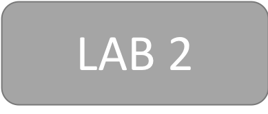
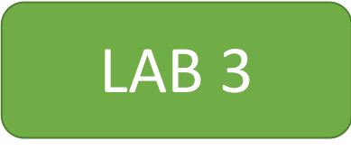

# Criando Soluções SaaS na AWS

# Aviso de segurança — leia antes de implantar

**Este bootcamp implanta deliberadamente uma API sem autorizador, e permanece assim até o final do
Lab 3.** Implante em uma conta descartável, não coloque dados reais nela e exclua a stack do
CloudFormation quando terminar. Os labs ensinam identidade, particionamento de dados e isolamento
em etapas; proteger a própria superfície da API não é uma dessas etapas. **Os padrões aqui não são
seguros para copiar para uma aplicação real.**

Resumidamente:

- Todos os 59 métodos do API Gateway em `resources/api-gateway.yml` usam `AuthorizationType: NONE`.
- O token JWT nunca é verificado: `source/shared-modules/token-manager/token-manager.js` usa
  `jwt-decode`, que apenas decodifica o payload e não confere assinatura, `iss`, `aud` nem `exp`.
- `POST /user/create` e `POST /user/system` aceitam `tenant_id` e `role` do corpo da requisição,
  sem ler nenhum cabeçalho `Authorization`.
- `source/product-manager/server.js` não verifica identidade em nenhuma rota.

**Se você implantou uma revisão anterior a este aviso:** o atributo `custom:role` era gravável pelo
próprio usuário final e também selecionava a role IAM de administrador do tenant, de modo que
qualquer usuário podia se promover a administrador com uma única chamada `UpdateUserAttributes`.
Isso foi corrigido neste repositório, mas implantações existentes não são atualizadas
automaticamente — revise os atributos graváveis dos seus app clients.

> **A versão completa e autoritativa deste aviso está no [README em inglês](README.md).** Esta
> tradução resume os pontos críticos; em caso de divergência, o texto em inglês prevalece.
>
> *Nota para mantenedores: esta tradução precisa de revisão por um falante nativo. Foi escrita junto
> com a correção de segurança para não deixar os leitores em português sem aviso nenhum.*

# Introdução
SaaS (Software as a Service) apresenta aos desenvolvedores uma combinação única de desafios: multi-tenancy, integração/onboarding, segurança, particionamento de dados, isolamento de tenants e identidade.

Uma das melhores maneiras de entender os princípios arquitetônicos de SaaS é examinar exemplos de design, construção e otimização. Neste workshop, vamos expor você aos principais conceitos da arquitetura SaaS, onde você pode ver as partes móveis de uma solução SaaS em ação.

Este workshop fornece uma série de atividades para os participantes interagirem com uma solução funcional e exercícios práticos que apresentam código e configuração para realizar e estender os recursos deste ambiente SaaS.

# Quem deve participar?
Os desenvolvedores e arquitetos de aplicações que desejam entrar em detalhes sobre a implementação de uma solução SaaS na AWS são incentivados a participar. O conteúdo do bootcamp/workshop é voltado para os mais novos com SaaS. No entanto, mesmo se você tiver experiência em SaaS, essa experiência ainda pode expô-lo a especificidades de uma arquitetura SaaS na AWS.

# Como começar?
Se você estiver participando deste workshop durante um evento da AWS, siga as instruções dos instrutores no local.

Se você gostaria de executar os exercícios do laboratório de maneira autoguiada, tudo que você precisa fazer é utilizar o template [workshop.yml](https://github.com/aws-samples/aws-saas-factory-bootcamp/blob/master/resources/workshop.yml) do AWS CloudFormation em sua conta da AWS e em seguida comece clicando no ícone do Lab 1 abaixo.

Observe que este workshop cria infraestrutura em sua conta da AWS que está fora do nível gratuito (free tier), e você deve excluir a stack do CloudFormation quando terminar para minimizar os custos. Os recursos do Amazon Cognito e as funções e políticas do AWS IAM criadas pelo sistema integrado precisarão ser removidos manualmente após a exclusão da stack.

# Laboratórios
### Lab 1 - Identidade e Onboarding/Integração

### Lab 2 - Microsserviços Multi-Tenant

### Lab 3 - Isolamento de Dados

# Licença
Este workshop é licenciado pela Licença Apache 2.0. Veja o arquivo de [LICENÇA](LICENSE).
