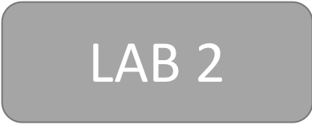

# Building SaaS Solutions on AWS

This Bootcamp is also available in [Portuguese (pt-br) language](README-pt-br.md).

# Security notice — read before deploying

**This bootcamp deliberately deploys an API with no authorizer, and it stays that way to the end of
Lab 3. Deploy it to a throwaway account, do not put real data in it, and delete the stack when you
finish.** The labs teach identity, data partitioning and isolation by building them up in stages;
securing the API surface itself is not one of those stages, so patterns here are **not** safe to
lift into an application.

What that means concretely, with file references so you can verify each point rather than take our
word for it:

- **Every API Gateway method is unauthenticated.** All 59 `AWS::ApiGateway::Method` resources in
  `resources/api-gateway.yml` are declared `AuthorizationType: NONE`. There is no Cognito authorizer
  and no Lambda authorizer anywhere in the stack. Of those 59, the 33 that carry an `HTTP_PROXY`
  integration pass straight through to an internal load balancer and reach the microservices; the
  other 26 are `MOCK` integrations serving CORS `OPTIONS` preflight and reach no backend. So every
  microservice route is reachable by anyone who has the API's invoke URL.
- **Tenant identity comes from an unverified token.** `source/shared-modules/token-manager/token-manager.js`
  reads claims with the `jwt-decode` library, which base64-decodes a JWT payload and checks
  nothing — no signature, no `iss` allowlist, no `aud`, no `exp`. Anyone can hand-craft a token
  carrying any `custom:tenant_id` and the services will act on it. Lab 2 moves tenant context out
  of request parameters and into the token, which is the right direction, but the token itself is
  still never verified.
- **`POST /user/create` takes its tenant and role from the request body.** `source/user-manager/server.js`
  reads no `Authorization` header and calls Cognito with the service's own IAM credentials, so a
  caller chooses the `tenant_id` and `role` of the user being created. This endpoint is built as an
  exercise in Lab 1 Part 3 and is invoked there with `curl` by design. `POST /user/system`, which
  provisions a **system administrator**, has the same shape.
- **Some services perform no identity check at all.** `source/product-manager/server.js` never reads
  an `Authorization` header on any route and uses the service's ambient IAM credentials for every
  DynamoDB operation, so the product catalogue is effectively public.
- **Lambda-backed custom resources pin Python 3.9** in `resources/baseline.yml` and
  `resources/workshop.yml`. AWS Lambda no longer permits new function creation on that runtime, so
  parts of the automation may fail on a fresh deployment. The core ECS microservices are unaffected.

If you adapt this material, the things to put in place are: a real authorizer in front of the API
(Cognito user pool or Lambda), signature-and-issuer verification of every token against a user pool
your deployment controls, tenant context taken only from a verified claim, and IAM policies scoped
with `dynamodb:LeadingKeys` conditions — which Lab 3 does teach.

**If you deployed a revision of this bootcamp dated before this notice**, one further item applies.
The `custom:role` attribute was previously writable by the end user while also selecting the
tenant's administrator IAM role, so any user could promote themselves to tenant administrator with
a single `UpdateUserAttributes` call. That has been corrected in `source/user-manager/cognito-user.js`,
and Lab 1 Step 12 now tells you to clear the write permission when you configure the app client by
hand. Existing deployments are not updated by a change to this repository: review the writable
attributes on your app clients, and treat any account in such a deployment as potentially having
held administrator access.

# Introduction
SaaS presents developers with a unique blend of challenges: multi-tenancy, onboarding, security, data partitioning, tenant isolation, and identity.

One of the best ways to understand architectural principles of SaaS is to dig into working examples of designing, building, and optimizing SaaS. In this bootcamp workshop, we’ll expose you to the core concepts of SaaS architecture by diving into a reference SaaS architecture where you can see the moving parts of a SaaS solution in action.

This workshop provides a series of activities for attendees to interact with a functional solution, and hands-on exercises that introduce code and configuration to realize and extend the capabilities of this SaaS environment. The combination of lecture and exercises through the lens of a working reference solution give greater insight into SaaS on AWS best practices.

# Who should participate?
Application developers and architects that are looking to get into the details of implementing a SaaS solution on AWS are encouraged to participate. The content of the bootcamp is geared toward those newer to SaaS. However, even if you have a background in SaaS, this experience could still expose you to specifics of delivering SaaS on AWS.

# How do I start?
If you are participating in this bootcamp workshop during an AWS event, follow the instructions of the instructors on site.

If you would like to run through the lab exercises in a self-guided manner, all you need to do is launch the [workshop.yml](https://github.com/aws-samples/aws-saas-factory-bootcamp/blob/master/resources/workshop.yml) AWS CloudFormation template in your AWS account and then start by clicking the Lab 1 icon below.

Note that this workshop deploys infrastructure into your AWS account that is outside of the free tier, and you should delete the CloudFormation stack when you are finished to minimize costs. The Cognito resources and IAM roles and policies created by the onboarding system will need to be removed manually after the stack delete. 

# Lab Guides
### Lab 1 - Identity and Onboarding

### Lab 2 - Multi-Tenant Microservices

### Lab 3 - Data Isolation

# License
This workshop is licensed under the Apache 2.0 License. See the [LICENSE](LICENSE) file.